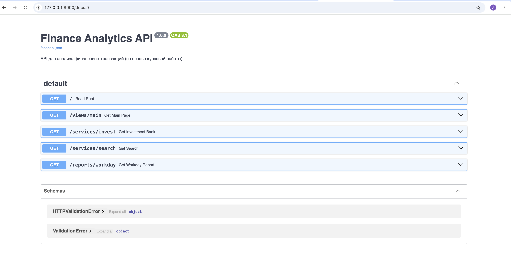

# Финансовый Аналитический Бэкенд

Приложение на Python для анализа и автоматической обработки финансовых транзакций из Excel-выгрузок. Проект предоставляет инструменты для генерации веб-отчётов, биржевых котировок, накопительных сервисов и комплексной аналитики расходов. Доступен как в виде консольного приложения, так и в виде REST API (FastAPI).

## 🛠 Технологический стек

* **Язык разработки:** Python 3.14+
* **Управление зависимостями:** Poetry
* **Анализ данных:** Pandas (чтение Excel, фильтрация, агрегация)
* **Веб-фреймворк:** FastAPI + Uvicorn (REST API и Swagger UI)
* **Работа с сетью:** Requests (интеграция со сторонними финансовыми API)
* **Тестирование:** Pytest + Pytest-cov (автоматические тесты и замер покрытия)
* **Качество кода:** Black (форматирование), Flake8 (линтер), iSort (сортировка импортов), Mypy (строгая типизация)

## 📁 Структура проекта

Проект спроектирован по современному стандарту коммерческой разработки **src-layout**:

```text
finance-analytics-api/
├── data/
│   └── operations.xlsx       # Исходный файл с банковскими транзакциями
├── docs/
│   └── screenshot_swagger.png # Скриншот документации API
├── src/
│   ├── __init__.py
│   ├── api.py                # FastAPI-приложение и эндпоинты
│   ├── main.py               # Точка входа для консольной проверки
│   ├── utils.py              # Вспомогательные утилиты
│   ├── views.py              # Логика формирования веб-страниц (Главная)
│   ├── services.py           # Реализация бизнес-сервисов (Инвесткопилка, Поиск)
│   └── reports.py            # Модуль генерации аналитических отчетов
├── tests/                    # Папка с автоматическими тестами
├── .env                      # Секретные API-ключи (игнорируется Git)
├── user_settings.json        # Файл настроек отслеживаемых валют и акций
├── pyproject.toml            # Конфигурация Poetry и утилит линтинга
└── README.md                 # Документация проекта
```

## 🚀 Функциональные возможности

### 1. Веб-страницы (`src/views.py`)
* **Главная:** Приветствие по времени суток, аналитика по картам (траты и кэшбэк), топ-5 транзакций, курсы валют и котировки акций S&P500.
* **События:** Анализ расходов и поступлений с группировкой по категориям. Поддерживает фильтрацию по периодам: неделя (`W`), месяц (`M`), год (`Y`) или все данные (`ALL`). Топ-7 категорий выделяются отдельно, остальное суммируется в «Остальное».

### 2. Сервисы (`src/services.py`)
* **Инвесткопилка:** Округляет расходы до заданного шага (10, 50 или 100 ₽) и считает, сколько удалось бы отложить за месяц.
* **Простой поиск:** Фильтрация транзакций по ключевому слову в описании или категории (без учёта регистра).
* **Выгодные категории кешбэка:** Анализирует, сколько потенциального кешбэка (1%) можно заработать по каждой категории за указанный месяц.

### 3. Отчёты (`src/reports.py`)
* **Траты в рабочий/выходной день:** Сравнивает средний чек расходов в будни и выходные за последние 3 месяца.
* **Траты по категории:** Показывает все траты по выбранной категории за 3 месяца.
* **Траты по дням недели:** Считает средние траты для каждого дня недели за 3 месяца.
* **Декоратор `@report_to_file`:** Автоматически сохраняет результаты любого отчёта в JSON-файл с временным штампом.

## 💻 Установка и запуск

### 1. Клонирование и подготовка окружения
Убедитесь, что у вас установлен менеджер пакетов Poetry. В терминале проекта выполните:
```bash
# Установка всех зависимостей проекта
poetry install
```

### 2. Настройка конфигурации
* Задайте интересующие вас акции и валюты в файле `user_settings.json`.
* Создайте файл `.env` в корне проекта и укажите ваши персональные ключи (требуется для работы живых курсов валют):
```text
EXCHANGE_API_KEY=ваш_ключ_exchangerate_api
```

### 3. Запуск приложения
Для проверки работы сервисов и веб-страниц запустите главный модуль:
```bash
poetry run python -m src.main
```

## 🌐 API Endpoints (FastAPI)

Проект также доступен в виде REST API. После запуска сервера интерактивная документация (Swagger UI) доступна по адресу: `http://127.0.0.1:8000/docs`.

### Запуск сервера:
```bash
poetry run uvicorn src.api:app --reload
```

### Доступные эндпоинты:

| Метод | Эндпоинт | Параметры | Описание |
| :--- | :--- | :--- | :--- |
| GET | `/views/main` | `dt` (YYYY-MM-DD HH:MM:SS) | Главная страница: приветствие, карты, топ-5, валюты, акции |
| GET | `/views/events` | `dt` (YYYY-MM-DD HH:MM:SS), `range` (W/M/Y/ALL) | Страница «События»: расходы и поступления по категориям |
| GET | `/services/invest` | `month` (YYYY-MM), `limit` (10/50/100) | Сервис «Инвесткопилка» |
| GET | `/services/search` | `query` (строка) | Поиск по описанию и категории |
| GET | `/services/cashback` | `year` (число), `month` (1-12) | Сервис «Выгодные категории кешбэка» |
| GET | `/reports/workday` | `date` (YYYY-MM-DD, опционально) | Средние траты в рабочий/выходной день |
| GET | `/reports/category` | `category` (строка), `date` (YYYY-MM-DD, опционально) | Траты по категории за 3 месяца |
| GET | `/reports/weekday` | `date` (YYYY-MM-DD, опционально) | Средние траты по дням недели |

### Скриншот документации (Swagger UI):


## 🧪 Тестирование и качество кода

### Запуск автоматических тестов:
Проект покрыт 18 изолированными тестами для проверки математики, парсинга дат и граничных условий:
```bash
poetry run pytest
```

### Проверка покрытия кода тестами (Coverage):
```bash
poetry run pytest --cov=src
```

### Проверка стиля кода и линтинг:
```bash
poetry run isort .   # Сортировка импортов
poetry run black .   # Форматирование кода по PEP 8
poetry run flake8 .  # Проверка линтером
poetry run mypy .    # Статический анализ типов
```
